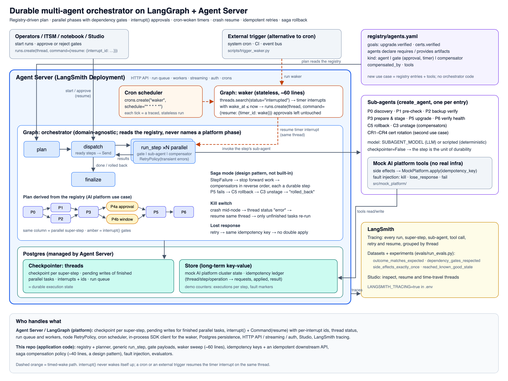
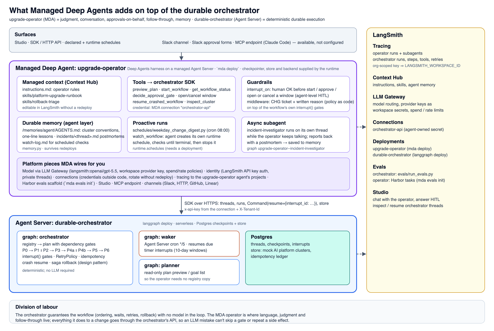

# Durable multi-agent orchestrator on LangGraph + Agent Server

A demo orchestrator for a long-running **AI platform upgrade** workflow, run on **Agent Server**. It is built to be compared against a Temporal implementation on the properties that matter for that kind of workflow:

- **Durable execution.** Kill a node mid-run, then resume from the last successful step. Finished parallel steps do not re-run.
- **Human approval waits.** `interrupt()` gates, resumed on the same thread with `Command(resume=...)`. Two gates can pause in parallel and resume independently.
- **Timed wake.** A maintenance window 10 days out is woken by an Agent Server cron (or an external trigger).
- **Failure recovery.** Retries with idempotent tools, including a lost-response case, plus saga compensation back to a known-good snapshot. Saga compensation is a **design pattern**, not a built-in feature.
- **Observability.** Every run is traced to LangSmith, and evaluators score the failure scenarios.

The orchestrator is **domain-agnostic**. It reads an agent registry and plans from it. The AI platform upgrade is one use case, and TLS certificate rotation is included as a second one to prove it. Every phase agent uses **mocked tools**. Nothing touches real infrastructure.

On top of it, [`upgrade-operator/`](upgrade-operator/) is a **Managed Deep Agent** that operates the orchestrator conversationally: plan previews, approvals on behalf of named humans, self-scheduled follow-ups, rollback investigation, and memory. See [Managed Deep Agents layer](#managed-deep-agents-layer).



(`docs/architecture.svg` is the editable source.)

---

## Quickstart

```bash
uv sync --all-extras                       # Python 3.11–3.13
cp .env.example .env                       # LANGSMITH_API_KEY (+ LANGSMITH_WORKSPACE_ID for org-scoped keys) for tracing
uv run langgraph dev                       # local Agent Server on http://127.0.0.1:2024 (+ Studio link)
uv run jupyter lab notebooks/walkthrough.ipynb
```

Other entry points:

```bash
uv run pytest                              # 8 scenario tests, in-process, ~5s
uv run python evals/run_evals.py --local   # evaluators, printed locally
uv run python evals/run_evals.py           # dataset + experiment in LangSmith
uv run python scripts/hard_kill_demo.py run && uv run python scripts/hard_kill_demo.py resume
uv run python scripts/create_cron.py       # register the waker cron (every minute)
uv run python scripts/trigger_waker.py --advance 10d   # external trigger; demo clock skew
```

### Deploy to Agent Server (LangSmith Deployment)

The repo is a standard LangGraph app (`langgraph.json` → graphs `orchestrator`, `waker` and `planner`).

1. Deploy from your laptop with `LANGSMITH_TENANT_ID=<workspace-id> uv run langgraph deploy --name durable-orchestrator` (beta; builds the image locally, `.dockerignore` keeps `.env` and `upgrade-operator/` out). Or push the repo to GitHub and create the deployment in **Deployments → New deployment**. For self-hosted, use `uv run langgraph build -t durable-orchestrator` and run the image with Postgres + Redis.
2. Register the waker cron against the deployment:
   ```bash
   LANGGRAPH_URL=https://<deployment-url> uv run --env-file .env python scripts/create_cron.py --schedule "*/5 * * * *"
   ```
3. Run the notebook against it: `LANGGRAPH_URL=https://<deployment-url> uv run --env-file .env jupyter lab`.

A full hosted setup is two deployments:

| Deployment | Created with | After deploying |
|---|---|---|
| `durable-orchestrator` | `langgraph deploy` (this directory) | register the waker cron (`*/5 * * * *`) |
| `upgrade-operator` (MDA) | `mda deploy` (in `upgrade-operator/`) | `mda connections create orchestrator-api --secret-from-env <VAR>`, and set `ORCHESTRATOR_URL` to the orchestrator URL |

> **Org-scoped keys.** An `lsv2_sk_…` service key must name its workspace or LangSmith rejects every call with 403. That includes trace uploads, which are dropped silently. Set `LANGSMITH_WORKSPACE_ID` in `.env` (tracing and SDK clients), `LANGSMITH_TENANT_ID` for `langgraph deploy`, and send `X-Tenant-Id` to hosted Agent Servers. The scripts and notebook do this automatically when `LANGSMITH_WORKSPACE_ID` is set.

---

## Architecture

```
START → plan → dispatch ──Send(step)×N──▶ run_step ──▶ dispatch … ──▶ finalize → END
                  ▲            (parallel)       │
                  └──────────── results ────────┘
```

| Piece | File | What it does |
|---|---|---|
| Registry | `registry/agents.yaml`, `registry.py` | Agents declare `requires` / `provides` artifacts, `kind` (`agent`, `gate`, `compensator`), tools, and `compensated_by`. Goals are terminal artifacts. |
| Planner | `planner.py` | Picks the goal (explicit `target`, an LLM if `PLANNER_MODEL` is set, or keyword match), backward-chains to the agents that are needed, derives the dependency gates from requires→provides, and layers the DAG topologically. Timer gates get an absolute `wake_at` **once, at plan time**, so replays are deterministic. |
| Scheduler | `graph.py` (`dispatch` + `route`) | Each pass sends every step whose dependencies have all succeeded. Steps that are ready together run in the **same super-step** (P1 ∥ P2, P4a ∥ P4b). After a `StepFailure` it switches to saga mode. |
| Executor | `graph.py` (`run_step`) | One generic node: runs a gate, a sub-agent, or a compensator. `RetryPolicy(retry_on=TransientInfraError)`. |
| Sub-agents | `subagent.py` | `create_agent` per registry entry, with that entry's mock tools. `SUBAGENT_MODEL` selects an LLM. If it is unset, a deterministic `ScriptedToolCaller` calls each tool once (reproducible, no keys needed). The sub-agent runs with `checkpointer=False`: **the step is the unit of durability**, like a Temporal activity. |
| Gates | `gates.py` | `interrupt()` with a typed payload. Approval resume value: `{"approved": bool, "approver", "comment"}`. Timer resume values: `{"action": "wake", "now"}`, `{"action": "override"}`, or `{"action": "cancel"}`. Invalid or early answers re-suspend the gate. |
| Waker | `waker.py` | Stateless graph run on a cron. It finds interrupted threads, picks timer interrupts with `wake_at ≤ now`, and resumes **only those interrupt ids**. |
| Saga | `saga.py` | **Design pattern, not built-in.** Reverse-order compensators, one durable step each. |
| Idempotency | `context.py`, `mock_platform/infra.py` | Key = `thread/step/operation`. The mock AI platform API de-duplicates by key, Stripe-style. |
| Fault injection | `faults.py` | `kill` (raise, or `os._exit`), `lose_response`, `fail`. Fire-once markers live in the store. |
| Mock AI platform | `src/mock_platform/` | Cluster state + idempotency ledger in the LangGraph Store, so the notebook can inspect it through the SDK. |

### AI platform phases (from the registry)

| Phase | Agent | Depends on | Notes |
|---|---|---|---|
| P0 | `P0_discovery` | — | read-only inventory |
| P1 | `P1_precheck` | P0 | health, compatibility, capacity. **Parallel with P2** |
| P2 | `P2_backup_verify` | P0 | takes a snapshot, records the **known-good** state |
| P3 | `P3_prepare_stage` | P1, P2 | stages the bundle. Compensator: `C3_unstage` |
| P4 | `P4a_change_approval` (approval gate) ∥ `P4b_maintenance_window` (timer gate) | P3 | **two gates paused in parallel** |
| P5 | `P5_upgrade` | P4a, P4b, P3, P2 | drain → control plane → workers → uncordon. Compensator: `C5_rollback` (also on failure) |
| P6 | `P6_verify_health` | P5 | smoke tests |

To add a use case, add registry entries and a tool module. `CR1–CR4` (cert rotation) show this with zero orchestrator changes.

---

## Scenarios (all in the notebook)

| Requirement | How it's shown | Evidence in the notebook |
|---|---|---|
| Plans with dependency gates | `build_plan` on the registry | layers `[P0] [P1,P2] [P3] [P4a,P4b] [P5] [P6]` |
| Approval gate, resumed on the same thread | `Command(resume={approval_id: …})` | thread stays `interrupted` on the timer only |
| Two gates paused in parallel, resumed independently | P4a ∥ P4b | resume P4a now, P4b later via the waker |
| 10-day timed wake | waker with `advance="10d"` (demo clock), plus a **live cron** waking a real 60-second window | woken interrupt id, thread `succeeded` (cron run: ~105 s) |
| Kill a node mid-run, resume from the last step | `faults.kill` in P2 while P1 runs in parallel | executions: P1 = 1, P2 = 2. Snapshot ledger: `requests=2, applied=1` |
| Real process death | `scripts/hard_kill_demo.py` (`os._exit(137)`, SQLite checkpoints, new process resumes) | same counts as above |
| Lost response recovered | `faults.lose_response` on `platform_upgrade_control_plane` | P5 ran twice. `requests=2, applied=1` for each replayed side effect |
| Saga compensation | `faults.fail` on `platform_upgrade_workers` (partial upgrade) | `undo:P5` then `undo:P3`. Cluster back to 1.8.2, green, unstaged |
| Domain-agnostic | cert rotation from a free-text goal | same assistant, different plan |
| Observability | LangSmith tracing + `evals/` | 4 evaluators × 6 scenarios |

---

## What Agent Server handles vs. what you would otherwise build

| Concern | Agent Server / LangGraph gives you | What you'd build yourself otherwise | What this repo adds |
|---|---|---|---|
| Durable state | Checkpoint per super-step in Postgres. Each finished parallel task's writes are saved as soon as it finishes, so a crash re-runs only unfinished tasks | A state machine + persistence layer + "what already ran" bookkeeping | – |
| Resume after a crash | Re-invoke the thread (`input=None`) and it continues from the last checkpoint. Runs whose worker stops heart-beating are re-queued (`BG_JOB_MAX_RETRIES`, default 3) | A recovery and replay process | – |
| Human waits | `interrupt()`, thread status `interrupted`, per-interrupt ids, `Command(resume=…)`, resume-by-id for parallel waits, Studio UI to answer them | A callback/signal API, correlation ids, a wait-state table | Gate payload schema + validation |
| Long timers | Cron scheduler, stateless runs, in-process SDK client (`get_client()` with no URL), delayed runs (`after_seconds`) | A durable timer service | The ~60-line `waker` sweep. A paused `interrupt()` has no built-in timer (unlike Temporal's `workflow.sleep`) |
| Retries | `RetryPolicy` per node (backoff, jitter, `retry_on`) | Retry loops | Error taxonomy: transient vs business vs crash |
| Idempotency | – (you need this on any engine) | – | Deterministic keys + idempotent downstream API |
| Compensation | Durable steps to build it on | Saga coordinator | `saga.py` (~40 lines, **a design pattern**) |
| Task queue / workers / scaling | Built in (Postgres + Redis), horizontally scalable | Queue, worker pool, leasing | – |
| API, streaming, auth, multi-tenancy | Built in (threads, runs, assistants, crons, store; custom auth) | API service | – |
| Tracing / evals | LangSmith: traces grouped by thread, datasets, experiments, Studio | A tracing stack + eval harness | 4 code evaluators |

### Mapping to Temporal concepts

| Temporal | Here |
|---|---|
| Workflow execution | Thread running the `orchestrator` graph |
| Activity | `run_step` (one sub-agent step). Retries via `RetryPolicy`, and it must be idempotent |
| Signal / Update | `Command(resume={interrupt_id: value})` |
| Durable timer (`workflow.sleep`) | Timer gate (`interrupt`) + cron-run `waker`. Not built in |
| Workflow replay determinism | Nodes re-execute from their start on resume. Code before `interrupt()` must be side-effect free, and plan-time values (`wake_at`) are fixed in state |
| Child workflows / parallel activities | `Send` fan-out within a super-step |
| Saga (samples library) | `saga.py`, application code |

---

## Design notes and caveats

- **Gate re-entry.** On resume, a gate node runs again from its start. In a super-step with two gates, resuming one re-enters both, and the other suspends again. That's why the gate executions counter reads 2–3 while the agents read 1.
- **A rejected approval while the other gate is still waiting.** A super-step finishes only when all of its tasks finish. If you reject P4a while P4b's window is days away, also cancel P4b in the same command: `{approval_id: {"approved": false}, timer_id: {"action": "cancel"}}`. Compensation then starts immediately. This is covered by `test_rejection_with_parallel_wait_cancelled`.
- **Durability mode.** The notebook passes `durability="sync"`, so each checkpoint is written before the next super-step starts. That's the right setting for long-running, side-effecting workflows.
- **Timed-wake granularity** is the cron schedule (1 min in the live demo, 5 min is typical in production). Per-thread alternative: `runs.create(..., after_seconds=N)` right after the gate pauses. The sweeper is more robust, because it survives re-planning and needs no stored run handles.
- **Demo clock.** `advance` / `simulate_now` on the waker exist only to compress 10 days into a demo. Leave them unset in production.
- **LLM sub-agents.** Set `SUBAGENT_MODEL=anthropic:claude-haiku-4-5` (or any `init_chat_model` id). A step fails (`StepFailure`) if the agent skips any of its required tools. The durability demos are deterministic only with the scripted model.

## Managed Deep Agents layer



The orchestrator is the **durable engine**: ordering, waits, retries and rollback, with no model in the loop. [`upgrade-operator/`](upgrade-operator/) is a **Managed Deep Agent** (MDA) on top of it. It is where people interact: in language, with judgment, following through over days and remembering past changes. Everything it does to a change goes through the orchestrator's API, so a model mistake can't skip a gate or repeat a side effect.

MDA can't host the orchestrator graph itself ("the agent only; for custom application code use Agent Server"). So these are **two deployments**, connected over the SDK. A small read-only `planner` graph on the orchestrator lets the operator preview plans without a copy of the registry.

| MDA capability | What it does here | Where | Verified |
|---|---|---|---|
| Deep Agents harness, hosted | Planning loop, file tools, `task` subagents, run on a managed Agent Server with no infrastructure to run | `agent.py` → `mda deploy` | local + hosted |
| Managed context (Context Hub) | Operator rules and two skills (upgrade runbook, rollback triage), editable in LangSmith without a redeploy | `instructions.md`, `skills/` | local + hosted |
| Custom tools | 11 SDK tools over the orchestrator: preview, start, status, gates, crash resume, cluster state | `tools/orchestrator.py` | local + hosted |
| Human-in-the-loop (`interrupt_on`) | A human approves the agent's own `start_workflow` / `decide_approval_gate` / window calls. This is a second layer on top of the workflow's `interrupt()` gates | `agent.py` | local |
| Middleware | Policy as code: approvals need a `CHG-` ticket, early windows need a written reason. Enforced even after HITL approval | `middleware/change_policy.py` | unit tests + local |
| Durable memory (agent layer) | Cluster conventions, one-line lessons, incident postmortems, watch log | `memory.py`, `/memories/agent/` | local |
| Async subagent | `incident-investigator` writes a postmortem in the background while the operator keeps talking | `agent.py` `subagents` | local |
| Declared schedule | Weekday 08:00 UTC change digest | `schedules/weekday_change_digest.py` | provisioned on deploy |
| Runtime schedules | `watch_workflow`: the agent schedules its own checks until the workflow ends, then deletes the schedule | `tools/follow_up.py` | hosted (created + listed) |
| Connections | The orchestrator API key is an agent-owned connection, not code or env | `mda connections create orchestrator-api` | hosted |
| LLM Gateway | `langsmith:openai/gpt-5.5` on the workspace's OpenAI provider key, with gateway spend/rate policies | `agent.py` | local + hosted |
| Identity | LangSmith API key auth with private threads (scaffold default) | `identity.py` | local + hosted |
| Not configured (needs a Slack app or a coding-agent session) | Slack channel + Slack approval forms (agent-owned interrupts), MCP endpoint for Claude Code, Harbor evals (`mda evals init`) | docs | – |

### What MDA adds vs. what you'd build on Agent Server alone

| Concern | Agent Server alone (orchestrator repo) | With MDA (upgrade-operator) |
|---|---|---|
| Agent runtime | You write the graph, `langgraph.json`, and the deploy | `define_deep_agent(...)` + `mda deploy` |
| Prompts and procedures | In code; a redeploy for every change | Context Hub: instructions + skills editable live |
| Long-term memory | Your own store schema | `memory.py`: hot/cold files, with access layers |
| Recurring and agent-created jobs | `crons.create` scripts (e.g. the waker) | `schedules/` declarations + `runtime.schedules` from tools |
| Credentials for tools | Env vars / your own secret store | Connections (agent- or user-owned, OAuth flows) |
| Chat surfaces | Build the integration | `channels/` (Slack, HTTP, GitHub, Linear) |
| Model access | Provider keys per deployment | LLM Gateway model strings and workspace policies |

### Run it

```bash
uv run langgraph dev --no-reload                  # orchestrator on :2024 (see note)
cd upgrade-operator && uv sync && uv run mda dev     # operator + Studio; set ORCHESTRATOR_URL=http://127.0.0.1:2024 in upgrade-operator/.env
```

Then in Studio: *"Upgrade aip-demo-01 to 1.9.0, window in 10 days."* The agent previews the plan, asks you to confirm, and pauses for HITL on `start_workflow`. It then reports the gates and sets up a watch (watches only work on a deployment). For the failure path: *"Failure demo: upgrade aip-demo-02 with the fail_upgrade fault…"*, then give a CAB approver + `CHG-` ticket and authorise opening the window. The saga rolls back, the investigator writes a postmortem, and the lesson is saved to memory.

> Run the orchestrator's `langgraph dev` with `--no-reload` while `mda dev` is running. Otherwise `upgrade-operator/.mda/dev/.venv` changes trigger reloads in the orchestrator. Never run two orchestrator dev servers from the same directory: they share `.langgraph_api/` persistence.

## Verified

`langgraph 1.2.24`, `langgraph-api 0.18.5` (local), Agent Server on LangSmith Cloud (hosted), `managed-deepagents 0.10.5`:

- `pytest`: 8/8 passing (orchestrator) and 3/3 passing (operator policy). `evals/run_evals.py --local`: 24/24 checks passing.
- Notebook executed end to end **against the local dev server and against the hosted deployment** (Postgres runtime): parallel gates, independent resume, 10-day wake, **live cron wake** (105 s local, 118 s hosted), kill/resume, lost response, saga, cert rotation. The `os._exit(137)` hard kill runs locally by design.
- Operator, local (`mda dev`): plan preview → HITL on start → CAB approval with ticket → failure demo → saga rollback → async investigator postmortem → memory writes.
- Operator, hosted: connection to the hosted orchestrator, gateway model, `list_active_workflows`, and runtime schedule creation (`watch_workflow`) plus the declared digest schedule.
- Not yet verified: a runtime-scheduled check firing end to end, and the LangSmith experiment upload (`evals/run_evals.py` without `--local`).

## Repo layout

```
registry/agents.yaml            # agents, goals, gates, compensators (AI platform upgrade + cert rotation)
src/durable_orchestrator/       # domain-agnostic: registry, planner, graph, gates, waker, saga, faults, planner_graph
src/mock_platform/              # mocked AI platform control plane + tools (no real infra)
scripts/                        # create_cron, trigger_waker, hard_kill_demo
evals/                          # evaluators + LangSmith experiment runner
notebooks/walkthrough.ipynb     # the demo
tests/                          # scenario tests
upgrade-operator/               # Managed Deep Agent on top (own pyproject, .env, mda CLI)
docs/architecture.{svg,png}, docs/managed-deep-agents.{svg,png}
langgraph.json                  # graphs: orchestrator, waker, planner
```
